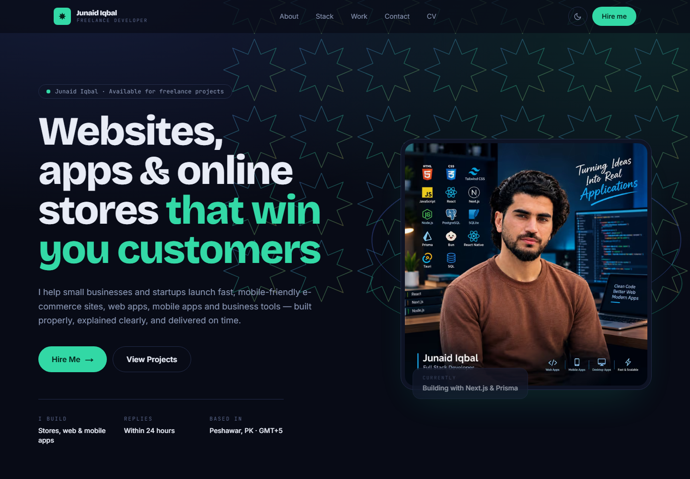

# Junaid Iqbal — Portfolio

My freelance portfolio: I build e-commerce websites, web apps, mobile apps and business applications for small businesses and startups.

**Live:** [junaid-dawar-portfolio.vercel.app](https://junaid-dawar-portfolio.vercel.app)



## What's inside

- **Home**: hero, services, projects with screenshots and live demo / GitHub links, about, skills, testimonials and a contact form
- **Contact**: form that emails me through [Resend](https://resend.com), plus WhatsApp click-to-chat, email, GitHub and LinkedIn
- **Dark and light mode**: follows the system setting, with a toggle in the header
- **SEO**: page titles and descriptions, a generated Open Graph share image, sitemap, robots.txt and JSON-LD structured data
- **Accessibility**: skip link, semantic headings, keyboard-friendly controls, and animations that switch off under `prefers-reduced-motion`

## Tech stack

Next.js 16 (App Router) · React 19 · TypeScript · Tailwind CSS 4 · Motion · GSAP · Vercel

## Run locally

```bash
pnpm install
pnpm dev
```

Open [http://localhost:3000](http://localhost:3000).

### Environment variables

| Name | Purpose |
| --- | --- |
| `RESEND_API_KEY` | Sends contact form messages (required for the form) |
| `CONTACT_TO_EMAIL` | Inbox that receives messages (defaults to my Gmail) |
| `CONTACT_FROM_EMAIL` | Sender address (defaults to Resend's shared sender) |
| `NEXT_PUBLIC_SITE_URL` | Canonical site URL used for SEO |

## Editing content

- Contact details, Freelancer.com link and SEO text: [`app/lib/site.ts`](app/lib/site.ts)
- Projects: [`app/select-project/select-project.tsx`](app/select-project/select-project.tsx) (screenshots live in `public/projects/`)
- Client reviews: [`app/testimonials/testimonials.tsx`](app/testimonials/testimonials.tsx)
